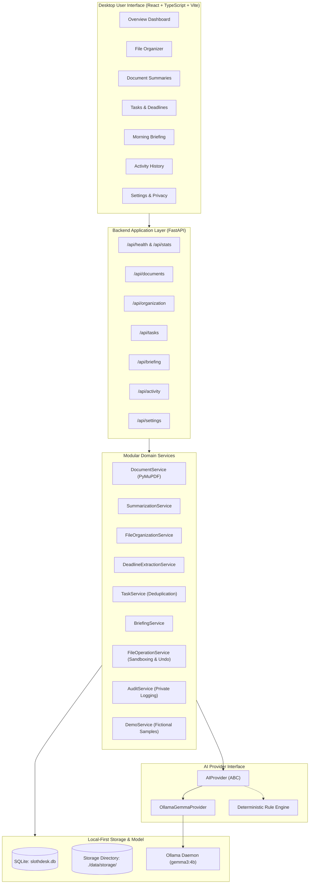

# SlothDesk AI

> **Do less busywork. Get more of your day back.**
>
> A local-first personal desktop productivity agent powered by **Google Gemma 3 4B Instruct**. Built for **Hacktoberfest 2026 — Week 3 Challenge: "Slow and Steady"**.

[](LICENSE)
[](https://www.python.org/downloads/)
[](frontend/)
[](https://ollama.com/library/gemma3)
[](tests/)

---

## The Problem & The Solution

Every day, developers, students, and freelancers drown in digital busywork:
- Messy desktop folders filled with generic filenames like `scan_001.pdf`, `invoice-final-v2(1).txt`, or `Syllabus_Fall_Updated.pdf`.
- Buried deadlines and surprise due dates tucked away on page 14 of a 30-page course syllabus or multi-page contractor agreement.
- Frantic morning routines spent switching between scattered task apps, calendar windows, and folders trying to identify what actually needs to get done today.

Most "AI productivity tools" attempt to solve this by exfiltrating your private files to cloud servers, charging subscription fees per token, and hallucinating answers.

**SlothDesk AI takes the opposite approach:**
Inspired by the **"Slow and Steady"** theme of Hacktoberfest Week 3, SlothDesk operates calmly, deliberately, and 100% locally on your computer. It handles the repetitive digital busywork without ever sending a single word of your documents over the internet.

---

## Key Features

1. **AI File Categorization & Intelligent Renaming:**
   - Drops chaotic collections of files into clean, sensible folders: `Documents`, `Education`, `Finance`, `Work`, `Images`, `Receipts`, or `Other`.
   - Analyzes document text to propose standardized, descriptive filenames.
   - **Explicit User Approval:** Displays a detailed preview before touching anything. Users can adjust categories or filenames inline before confirming.
   - **Collision-Safe & Non-Destructive:** Existing files are never overwritten silently.

2. **Document Summaries & Action Item Extraction:**
   - PyMuPDF text extraction for PDFs and plain-text files.
   - Concise executive summaries generated with Gemma 3 4B.
   - Automatic extraction of actionable to-do items and key milestones.
   - **Scanned PDF Honesty:** Detects scanned physical pages and explains that OCR is needed instead of pretending text was read.
   - 1-click Markdown export.

3. **Tasks & Deadlines Manager:**
   - Auto-registers extracted deadlines into a prioritized task list.
   - **Duplicate Prevention:** Content-hash deduplication ensures reprocessing a syllabus or agreement never duplicates existing tasks.
   - Priority tags (High, Medium, Low) and overdue/due-today status alerts.

4. **Calm Morning Briefing:**
   - Synthesizes your real tasks and documents into a focused daily agenda.
   - Highlights your **Top 3 Priorities for Today**, deadlines due today, and suggested calm next actions.
   - Features daily **"Words of the Sloth"**—grounding reflections on steady progress over frantic multitasking.

5. **Safe File Operations & Batch Undo:**
   - Path-traversal defense guarantees files cannot be moved outside approved workspace directories.
   - Every file batch operation can be reversed with a single click of the "Undo Last Batch" button.

6. **1-Click Hackathon Demo Mode:**
   - Bundles fictional academic, financial, contractual, and receipt documents so reviewers can test the entire workflow with zero private documents.

---

## Architecture Diagram



---

## Why Open Innovation Wins Here

*(A technical and ethical comparison of open-weight models versus closed APIs)*

Personal desktop productivity is fundamentally incompatible with multi-tenant cloud AI APIs:

1. **Zero Data Exfiltration:** Tax forms, employment agreements, student grades, and bank invoices should not leave your device. Google Gemma 3 4B runs locally through Ollama on your own CPU/GPU memory bus.
2. **True Air-Gapped Offline Operation:** Whether on a flight, at a remote cabin, or during internet disruptions, SlothDesk AI functions identically offline.
3. **No Metered Subscription Tollgates:** Cloud AI providers charge continuous token fees for repetitive tasks. With Gemma 3 4B, sorting 10,000 files incurs \$0 in API invoices—bounded only by your device's electricity.
4. **Permanent Software Ownership:** Your productivity setup cannot be deprecated, modified, or canceled by a remote API provider's sudden pricing or policy shifts.
5. **Honest Fallback Engineering:** When the model daemon is offline, SlothDesk AI never fabricates inference. It clearly switches to a deterministic heuristic rule engine and guides the user through starting the local model.

---

## Technology Stack

- **Backend:** Python 3.13/3.14, FastAPI, SQLAlchemy 2.0, SQLite, PyMuPDF, Pydantic v2.
- **Frontend:** React 18, TypeScript, Vite, Tailwind CSS, Lucide Icons.
- **AI Inference:** Google Gemma 3 4B Instruct (`gemma3:4b`) via local Ollama HTTP API.
- **Testing:** pytest & HTTPX TestClient for backend, Vitest & React Testing Library for frontend.
- **Deployment:** Docker, Docker Compose, and Render Docker configuration.

---

## Quickstart & Local Setup

### Prerequisites
- Python 3.11+ (Python 3.13/3.14 fully supported)
- Node.js 18+ and npm
- [Ollama](https://ollama.com/) (for live Gemma 3 4B local inference)

### 1. Clone & Set Up Environment

```bash
git clone https://github.com/rudrakshk25060-csds/slothdesk-ai.git
cd slothdesk-ai

# Backend virtual environment
python3 -m venv .venv
source .venv/bin/activate
pip install -r backend/requirements.txt

# Frontend dependencies
cd frontend
npm install
cd ..
```

### 2. Set Up Local Gemma 3 4B

```bash
# In your terminal
curl -fsSL https://ollama.com/install.sh | sh
ollama pull gemma3:4b
ollama serve
```

### 3. Build & Run Application

You can start the full stack in one of two ways:

#### Option A: Convenient Production Mode (Single Port 8000)
```bash
./scripts/build.sh
./scripts/start.sh
```
Open **http://localhost:8000** in your browser. FastAPI serves both the REST API and the React frontend.

#### Option B: Development Mode (Hot-Reloading)
```bash
# Terminal 1: Backend
cd backend
uvicorn app.main:app --reload --port 8000

# Terminal 2: Frontend
cd frontend
npm run dev
```
Open **http://localhost:5173** (Vite proxies `/api` requests to port 8000).

---

## Hackathon Demo Mode (Zero Personal Files Needed)

To evaluate SlothDesk AI without uploading personal documents:

1. Launch the application and click the **“Load Demo Workspace”** button in the header (or run `./scripts/run-demo.sh`).
2. SlothDesk automatically loads fictional sample files into your local storage:
   - `CS101_Fall2026_Syllabus.txt` (Education)
   - `AcmeCorp_Invoice_INV-2026-881.txt` (Finance)
   - `Freelance_Design_Agreement.txt` (Work)
   - `BlueBottleCoffee_Receipt_Oct2026.txt` (Receipts)
   - `Scanned_Archived_Memo_Sample.txt` (Scanned PDF OCR demonstration)
3. Navigate to **File Organizer** &rarr; Click **"Generate AI Organization Plan"** &rarr; Inspect proposals &rarr; Approve and execute.
4. Navigate to **Document Summaries** &rarr; Review extracted action items, deadlines, and markdown export.
5. Navigate to **Tasks & Deadlines** &rarr; Verify deduplicated tasks and check off completed items.
6. Navigate to **Morning Briefing** &rarr; Click **"Generate Today's Briefing"** &rarr; Review today's 3 focus priorities and sloth reflection.
7. Navigate to **Activity History** &rarr; Inspect the audit trail.

---

## Automated Test Results

SlothDesk AI includes automated tests covering all 22 required hackathon specifications:

```bash
./scripts/test.sh
```

### Actual Test Execution Output:
```text
=== Running Backend Tests (pytest) ===
tests/test_all_features.py::test_01_health_and_readiness PASSED          [  4%]
tests/test_all_features.py::test_02_ai_provider_unavailable PASSED       [  9%]
tests/test_all_features.py::test_03_valid_pdf_extraction PASSED          [ 14%]
tests/test_all_features.py::test_04_malformed_pdf_handling PASSED        [ 19%]
tests/test_all_features.py::test_05_txt_extraction PASSED                [ 23%]
tests/test_all_features.py::test_06_summary_response_validation PASSED   [ 28%]
tests/test_all_features.py::test_07_deadline_extraction_validation PASSED [ 33%]
tests/test_all_features.py::test_08_task_creation_and_completion PASSED  [ 38%]
tests/test_all_features.py::test_09_duplicate_task_prevention PASSED     [ 42%]
tests/test_all_features.py::test_10_file_classification PASSED           [ 47%]
tests/test_all_features.py::test_11_rename_proposals PASSED              [ 52%]
tests/test_all_features.py::test_12_filename_collisions PASSED           [ 57%]
tests/test_all_features.py::test_13_path_traversal_prevention PASSED     [ 61%]
tests/test_all_features.py::test_14_approval_required PASSED             [ 66%]
tests/test_all_features.py::test_15_file_operation_execution PASSED      [ 71%]
tests/test_all_features.py::test_16_file_operation_undo PASSED           [ 76%]
tests/test_all_features.py::test_17_unauthorized_filesystem_access PASSED [ 80%]
tests/test_all_features.py::test_18_activity_logging PASSED              [ 85%]
tests/test_all_features.py::test_19_morning_briefing_generation PASSED   [ 90%]
tests/test_all_features.py::test_20_empty_state_behavior PASSED          [ 95%]
tests/test_all_features.py::test_21_export_and_data_clearing PASSED      [100%]
======================== 21 passed in 0.13s ========================

=== Running Frontend Tests (vitest) ===
 ✓ tests/App.test.tsx (5 tests) 146ms
   ✓ renders application branding and header elements
   ✓ navigates to File Organizer and displays workspace files
   ✓ navigates to Tasks & Deadlines and displays tasks
   ✓ navigates to Morning Briefing and displays the agenda
   ✓ toggles light and dark themes successfully

✅ All Backend & Frontend Tests Passed Successfully!
```

---

## Known Limitations & Future Improvements

- **Scanned Document OCR:** SlothDesk AI currently detects scanned PDFs and alerts the user when an OCR layer is missing. A future improvement is an optional on-device Tesseract or lightweight vision-OCR pipeline.
- **Native OS File Watchers:** Currently, organization is triggered manually or by folder scan. Adding a background watchdog daemon can automatically queue incoming files in `~/Downloads` for review.
- **Model Quantization Options:** While `gemma3:4b` is the primary model, supporting smaller 2B models for low-power laptops and 12B/27B models for powerful workstations via a setting toggle would expand device coverage.

---

## Hacktoberfest 2026 Submission Draft

- **Project Name:** SlothDesk AI
- **Tagline:** Do less busywork. Get more of your day back.
- **Challenge:** Hacktoberfest 2026 — Week 3 ("Slow and Steady")
- **Open Model:** Google Gemma 3 4B Instruct (`gemma3:4b`) via local Ollama HTTP API
- **Repository:** `https://github.com/rudrakshk25060-csds/slothdesk-ai`
- **Core Value:** Local-first document organization, deadline extraction, and daily morning briefings with complete privacy and zero cloud token fees.
- **Key Innovation:** A calm desktop assistant that requires explicit user confirmation before moving files, prevents path traversal, provides batch undo, and avoids false claims when local models are unavailable.

---

## License

This project is licensed under the [MIT License](LICENSE).
