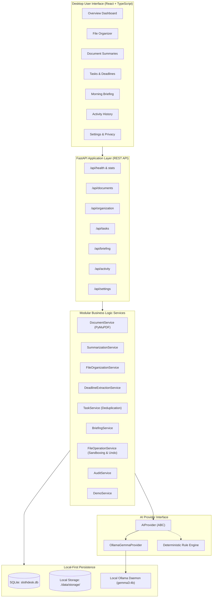

# SlothDesk AI Architecture Documentation

## System Overview

SlothDesk AI is built as a modular, local-first application comprising:
1. **Frontend:** React 18, TypeScript, Vite, and Tailwind CSS.
2. **Backend:** FastAPI (Python 3.13/3.14 compatible), SQLAlchemy, SQLite, and PyMuPDF.
3. **AI Inference:** Local Ollama HTTP daemon running Google Gemma 3 4B Instruct (`gemma3:4b`).

## Security & Path Traversal Mitigations

1. **Approved Root Sandboxing:** `FileOperationService` validates all client-supplied target and source paths against approved root directories (`storage`, `data`, `sample_files`). Attempts to escape with `../` or access `/etc/` raise HTTP 403 Forbidden.
2. **Collision-Safe Renaming:** If a file `report.pdf` already exists in a destination folder, SlothDesk automatically generates `report_1.pdf`, `report_2.pdf` etc. It never overwrites without explicit user authorization.
3. **Audit Privacy:** The `AuditService` logs operation metadata, batch IDs, counts, and categories, but **never logs raw document text or sensitive file content**.
4. **Scanned PDF Handling:** If a PDF is a scanned image with no embedded text layer, `DocumentService` flags `is_scanned=True` and instructs the user to run an OCR pipeline rather than hallucinating text.
